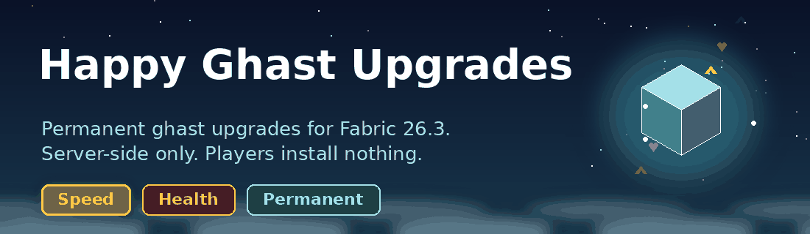
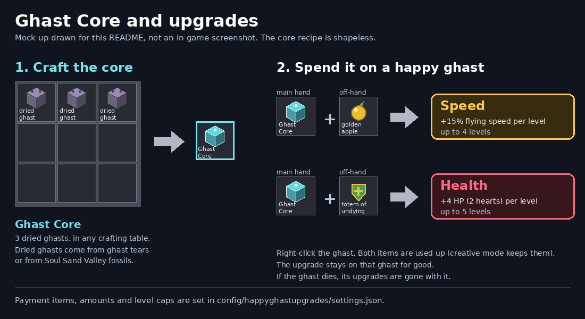

# Happy Ghast Upgrades



**Permanent speed and health upgrades for the happy ghast, without asking a single player to install anything.**

Happy Ghast Upgrades is a Fabric mod that runs only on the server. Players join with a normal, unmodified Minecraft client, craft a Ghast Core, and spend it on their ghast.

> Status: **early** (0.1.0), not a 1.0 release. The server-side logic is tested on a real 26.3 server in CI. The in-game feel (right-clicking, riding speed) still needs more play-testing. See [Known issues](#beta-notes-and-known-issues).

## Why it exists

Happy ghasts are a great way to travel and haul a group around, but they never get better. Dried ghasts pile up in chests, and a ghast you have kept alive for weeks is worth exactly the same as a fresh one.

This mod gives that stockpile a purpose and gives your ghast a history. Gather dried ghasts, turn them into a Ghast Core, and spend it, with a golden apple or a totem of undying, to make one particular ghast faster or tougher for good.

It follows the same rule as [Boss Altars](https://github.com/hashim-1610/boss-altars): **everything players see is already in the game.** The core is a vanilla item with a custom name and model, the recipe is plain datapack JSON, and the upgrades are ordinary attribute modifiers.

## Who it is for

* **Server owners** who want a long-term goal around the happy ghast, without a client mod or resource pack.
* **Small friend servers** and **survival SMPs** where one well-loved ghast is the group's shared ride.
* **Operators who like to tweak.** The payment items, the amount per level and the level caps are all in one JSON file.

## How it plays

1. **Collect** dried ghasts (crafted from ghast tears, or found in Soul Sand Valley fossils).
2. **Craft a Ghast Core** from 3 dried ghasts in any crafting table.
3. **Choose the upgrade.** Hold the core in your main hand and the payment item in your off-hand.
4. **Right-click the happy ghast.** Both items are used up and the upgrade is applied for good.



| Off-hand item | Upgrade | Per level | Max |
|---|---|---|---|
| Golden apple | Speed (flying speed) | +15% | 4 levels |
| Totem of undying | Health (max health) | +4 HP (2 hearts) | 5 levels |

Holding a core with the wrong off-hand item shows a hint instead of doing anything. Without a core in your hand, right-clicking a ghast behaves exactly as in vanilla (riding, feeding). A ghast at its maximum level refuses the upgrade and keeps your items.

The upgrades belong to the ghast, not the player. If the ghast dies, its upgrades are gone, which is a good reason to look after it.

## Why server-side matters

* **Nothing for players to install.** No mod, no resource pack, no mod-version mismatch between players.
* **Everything runs on vanilla mechanics.** The core is a normal item, the recipe is a datapack recipe, and the upgrade is a vanilla `/attribute` modifier that Minecraft saves with the entity.
* **Nothing to maintain on the side.** There is no database or extra save file. The upgrade level is stored on the ghast itself, so it survives restarts, chunk unloads and moving the world.
* **Light on the server.** There is no tick loop. The mod only does work at the moment a player right-clicks a ghast with a core.

## Get started

1. Download `happy-ghast-upgrades-<version>.jar` from the [releases page](https://github.com/hashim-1610/happy-ghast-upgrades/releases). While the mod is in early development, the newest build is the [latest dev build](https://github.com/hashim-1610/happy-ghast-upgrades/releases/tag/dev-latest).
2. Put it and Fabric API in your server's `mods/` folder. You need Minecraft 26.3, Fabric Loader 0.19.5+ and Java 25.
3. Start the server. A settings file is created at `config/happyghastupgrades/settings.json`.
4. Craft a Ghast Core and try it on a happy ghast. Operators can also run `/happyghast core` to get one.

## Everyday commands

| Command | Who | What it does |
|---|---|---|
| `/happyghast info` | everyone | Explains the steps |
| `/happyghast core` | operators | Gives yourself a Ghast Core |
| `/happyghast apply speed` or `health` | operators | Applies one level to the nearest happy ghast within 16 blocks, without using any items (handy for testing) |
| `/happyghast reload` | operators | Reloads `settings.json` |

## Configuration

`config/happyghastupgrades/settings.json` is created on first start:

```json
{
  "speed":  { "item": "minecraft:golden_apple",     "attribute": "minecraft:flying_speed", "operation": "add_multiplied_base", "per_level": 0.15, "max_levels": 4 },
  "health": { "item": "minecraft:totem_of_undying", "attribute": "minecraft:max_health",   "operation": "add_value",           "per_level": 4.0,  "max_levels": 5 }
}
```

| Key | Meaning |
|---|---|
| `item` | The off-hand item that selects this upgrade |
| `attribute` | The attribute that gets the modifier |
| `operation` | `add_value`, `add_multiplied_base` or `add_multiplied_total` (the vanilla `/attribute` operations) |
| `per_level` | Amount added per level |
| `max_levels` | Level cap (1 to 100) |

Run `/happyghast reload` after editing. Any invalid value falls back to its default and is written to the server log, so a typo never breaks the mod. The Ghast Core recipe is a datapack file (`data/happyghastupgrades/recipe/ghast_core.json`), so it can be overridden with a normal datapack.

## How it is built

* **The Ghast Core** is a vanilla `disc_fragment_5` with a custom name, a `custom_data` flag and the `item_model` of a dried ghast. On a vanilla client it shows as a glowing ghast-face cube named "Ghast Core".
* **The upgrade** is an attribute modifier added with the vanilla `/attribute` command. A tag on the ghast (`hgu_speed_N`, `hgu_health_N`) remembers the level.
* **Right-clicks** are caught with Fabric's `UseEntityCallback`. Only a main-hand Ghast Core on a happy ghast is handled; everything else passes through untouched.
* **Tested in CI.** Every push builds the mod and runs `tools/smoke.sh`, which boots a real 26.3 server, spawns a happy ghast, applies upgrades, checks the level cap, then restarts the server to confirm the upgrades persist.

## Compatibility and roadmap

* **Now:** Minecraft Java 26.3. Bedrock is not supported.
* **Maybe later:** a third upgrade (armor or knockback resistance), and an optional resource pack for a fully custom Ghast Core look.
* Other Minecraft versions would each need their own build.

## Beta notes and known issues

This mod was built for one community and is still early, so expect rough edges.

* **Riding speed is not yet confirmed in-game.** The speed upgrade raises the ghast's `flying_speed` attribute (checked in CI), but it has not been confirmed that the value changes how fast a ridden ghast flies. If it does not, switch the attribute in `settings.json`.
* **The right-click flow has not been play-tested by a person yet.** The logic is tested, but the hand-and-click handling needs a real player.
* **The Ghast Core is a real `disc_fragment_5` underneath.** Nine of them could in theory be crafted into a music disc, which would cost 27 dried ghasts for one disc.
* **Upgrades are lost when the ghast dies.** That is by design.

Found a bug? Open a [GitHub issue](https://github.com/hashim-1610/happy-ghast-upgrades/issues), or tell the server team directly.

## Regenerating the images

`python3 tools/render_images.py` redraws the banner and the recipe picture. They are drawn from scratch with Pillow (`pip install pillow`) and use no Minecraft textures.

MIT license, by FiReWoLf.
